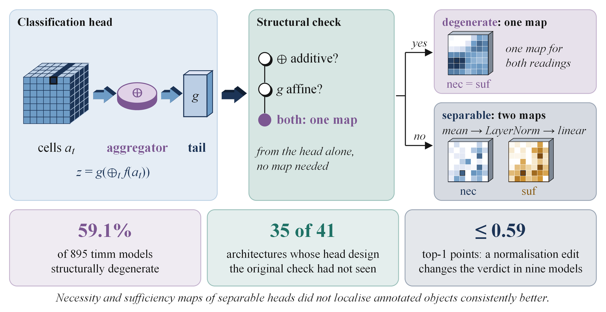

<div align="center">

# Necessity versus Sufficiency in Last-Layer Class Activation Maps

### A Structural Check of the Classification Head

**Oguzhan Katar**  
Firat University, Elazig, Türkiye

[](https://www.python.org/)
[](LICENSE)
[](#citation)

</div>

A class activation map is often read as showing which regions of an image were necessary for a class score, or which were sufficient for it. For maps drawn at the last feature map, the two readings are the same quantity whenever the classification head pools the cells additively and applies only affine layers after pooling, as the common global-average-pooling head does. This repository contains the structural check that reads a network's head and says whether the two maps can differ at all, and if they can, which operation makes the difference. It also holds every analysis behind the article: the double-precision census of 895 ImageNet models, the evaluation of the check on architectures it had not seen, the normalisation edits and their accuracy cost, and the localisation experiments on natural and medical images, together with the raw results and a script that re-derives every reported number from them.

<p align="center">
  
</p>

## Key findings

| | |
|---|---|
| **Most heads cannot separate the two maps** | In double precision, **529 of the 895** ImageNet-1k models of the timm library (**59.1%**) are structurally degenerate: their necessity and sufficiency maps are identical. |
| **The check holds on unseen head designs** | The original check, written before the census, agrees with **879 of 895 census labels** and with **35 of 41 architectures** whose head design it had not seen. |
| **A conservative check that may abstain** | The conservative version gave **no false degenerate verdict on torchvision** and **one on 32 heads built to break it**. |
| **Where separation can arise** | Only in the aggregator or after it. Log-sum-exp pooling of class scores keeps the cell ordering, channel-wise pooling before a linear layer does not. |
| **Grad-CAM coincides with CAM** | At fixed head weights, Grad-CAM equals the class activation map under every shift-equivariant aggregator. |
| **One layer decides the verdict** | In nine models one normalisation layer decides the verdict, at a cost of at most **0.59 top-1 points**. |
| **No consistent localisation gain from separation** | The necessity and sufficiency maps of separable heads won **39** and lost **26 of 96** primary contrasts with frozen backbones, **1** and **5 of 6** when trained end to end, and gave no consistent gain on three medical datasets. |

## Check your own model

The check needs only the module structure, so random weights give the same verdict as trained ones. It runs on a CPU in seconds.

```bash
pip install -r scripts/requirements-check.txt          # torch, timm, numpy
python scripts/check_conservative.py resnet50           # any timm model name
python scripts/check_conservative.py resnet18 --torchvision           # a torchvision classifier
python scripts/check_conservative.py swin_t --torchvision --certify   # with the float64 certificate
```

From Python, run from the repository root:

```python
import sys, timm
sys.path.insert(0, "scripts")
from check_conservative import check_conservative, certify, torchvision_model

print(check_conservative(timm.create_model("convnext_tiny")))
# {'original': 'normalisation-blocked', 'audited': 'normalisation-blocked',
#  'conservative': 'normalisation-blocked', 'operation': 'head.norm(LayerNorm2d)', ...}
```

`check_conservative.py` prints three verdicts side by side:

* **original**, the check as it was fixed before the census (`scripts/heldout/frozen_rule.py`, imported unchanged),
* **audited**, the original verdict after three pattern rules for the blind spots found by the census audit,
* **conservative**, which returns degenerate only when every condition of `protocols/K1_sound_check_protocol.md` is verified, and unknown otherwise.

Rely on the conservative verdict. The possible verdicts are degenerate, normalisation-blocked, nonlinearity-blocked, aggregator-blocked, class-token and, for the conservative check, unknown. Unknown means that the structure alone does not decide, so measure instead: `--certify` (or `certify()`) runs the float64 additivity certificate of the article on the model's head. `check_conservative(model, x=None)` needs a model with `forward_features` and `forward_head`, the timm convention, and `torchvision_model(name, model=None)` wraps a torchvision classifier in that form (pass an instance, for example with trained weights, to wrap it).

On `resnet50`, `convnext_tiny` and `vit_base_patch16_224` from timm and `resnet18` from torchvision the three checks agree: degenerate, normalisation-blocked, class-token and degenerate. On torchvision's `swin_t` the original and audited checks return degenerate and the conservative check returns unknown, because a permutation before the pool is not on its list of operations verified cell by cell. The certificate then measures the head as additive.

To compute both maps for a head on a timm feature map, `scripts/crosscheck/rtlib.py` holds an independently written estimator, `NS_literal(head, XA, XB, c)`, which substitutes one cell at a time in float64 (usage in [`docs/REPRODUCIBILITY.md`](docs/REPRODUCIBILITY.md)).

## Repository structure

```
cam-necessity-sufficiency-check/
├── scripts/                  analysis code, run from the repository root
│   ├── check_conservative.py   original, audited and conservative verdicts of one model
│   ├── check_model.py          original and audited verdicts in the article's terms
│   ├── verify_numbers.py       re-derives the reported numbers from the stored results
│   ├── requirements-check.txt  minimal CPU-only requirements of the three scripts above
│   ├── probe*.py               operator sweeps, aggregator and tail replacements, the normalisation
│   │                           edit, the 1,000-class experiment, eight CAM-based methods
│   ├── nslib.py, heads.py, pilot.py, cache_feats.py, get_in1k.py   shared machinery and data access
│   ├── scope/                  development of the check on 66 architectures
│   ├── heldout/                the check as fixed (frozen_rule.py), held-out evaluation, repair costs
│   ├── wsol/                   localisation on CUB-200-2011, PASCAL VOC 2012 and MS-COCO
│   ├── medical/                NIH ChestX-ray14, RSNA Pneumonia and ISIC
│   └── crosscheck/             independently written float64 estimator, reference sensitivity
├── src/nscam.py              map computation used by pilot.py
├── analyses/                 further analyses, each with scripts/ and out/
│   ├── check_census/             census of 895 architectures, trace novelty, baselines, McNemar tests
│   ├── check_audit/              audit of the check, 32 constructed heads, audited census counts
│   ├── conservative_check_census/  conservative check and the float64 census, torchvision, channel-wise pooling
│   ├── theory_sweeps/            softmax contrasts, locus of separation, Grad-CAM, faithfulness
│   ├── closed_form_maps/         cancellation-free closed-form log-sum-exp maps and the sweeps recomputed
│   ├── localisation_reanalysis/  plain-CAM comparator, image-level re-analysis, temperatures, refitted head
│   ├── localisation_extra/       within-model contrasts, protocol control rows, rank separation
│   ├── end_to_end_cub/           ResNet-50 trained end to end on CUB-200-2011 with four heads, three seeds
│   ├── medical_baselines/        training overlap, cross-fitted RSNA models, average-box baselines
│   ├── medical_extra/            closed-form medical primaries, conjunctive sufficiency, cluster bootstrap
│   ├── isic_three_seeds/         the ISIC arm with three retrained classifiers
│   └── extended_tables/          tables of the extended document recomputed from the stored results
├── outputs/                  raw results of scripts/ (JSON, logs, per-record arrays)
├── protocols/                protocols written before the outcomes, with their SHA-256 digests
├── data/                     NIH split lists; datasets are fetched here or to a cache (data/README.md)
├── docs/
│   ├── REPRODUCIBILITY.md        every table, figure and number of the article mapped to code and results
│   └── EXTENDED_METHODS_RESULTS_TABLES.pdf   extended methods, extended results, Tables S1-S19, Figures S1-S6
├── assets/                   figure used in this README
├── requirements.txt          exact package versions of the reported runs
└── environment.yml           conda environment
```

## Reproducing the numbers

```bash
git clone https://github.com/oguzhankatar/cam-necessity-sufficiency-check.git
cd cam-necessity-sufficiency-check
pip install -r scripts/requirements-check.txt
python scripts/verify_numbers.py
```

`verify_numbers.py` runs on a CPU in a few seconds. It reads the stored results in `outputs/` and `analyses/*/out/` and prints the numbers of the article and of the extended document: the verdict tables, the census, the three checks on constructed heads, architectures and torchvision, the normalisation edits, the operator sweeps, the localisation and medical contrasts, the end-to-end heads and the three ISIC seeds. No model is run.

To rerun an analysis, create the full environment and run the script named for it in [`docs/REPRODUCIBILITY.md`](docs/REPRODUCIBILITY.md), from the repository root:

```bash
conda env create -f environment.yml
conda activate cam-ns-check
```

The reported runs used Python 3.11.15, PyTorch 2.6.0 (CUDA 12.4) and timm 1.0.27 on Windows 11 with one NVIDIA RTX 4090. The census certification, the localisation runs, the end-to-end training and the medical arms need a GPU. Every script writes to the `out/` folder (or `outputs/` subfolder) where its stored results are, so a rerun can be compared with the stored files directly.

## Data

All datasets are public and are not redistributed: ImageNet-1k (a public re-encoded validation mirror), Imagenette, Imagewoof, CIFAR-100, CUB-200-2011, PASCAL VOC 2012, MS-COCO val2017, NIH ChestX-ray14, the RSNA Pneumonia Detection Challenge and ISIC 2017/2018. Pretrained weights come from timm, torchvision and TorchXRayVision. [`data/README.md`](data/README.md) lists which script fetches or reads each dataset and where it is stored. The checkpoints of the classifiers trained here (about 1.4 GB) are not included. They are available on request, and the scripts named in the reproducibility map retrain them.

## Release assets

Four archives of per-record arrays are too large for the repository and are attached to the GitHub release instead. None is needed by `verify_numbers.py`. Each archive holds the files under their repository paths, so unpacking it at the repository root restores them (`unzip <file> -d .`).

| File | Size | Contents | Regenerated by |
|---|---|---|---|
| `end_to_end_cub_per_image.zip` | 242.0 MB | 15 arrays for `analyses/end_to_end_cub/out/per_image/` | `analyses/end_to_end_cub/scripts/k2_eval.py` |
| `end_to_end_cub_natural_maps.zip` | 244.6 MB | 12 arrays for `analyses/end_to_end_cub/post/out/per_image/` | `analyses/end_to_end_cub/post/scripts/k2_natural.py` |
| `end_to_end_cub_rank_curves.zip` | 118.2 MB | 1 array for `analyses/end_to_end_cub/post/out/per_image/` | `analyses/end_to_end_cub/post/scripts/k2_rank.py` |
| `localisation_iou_curves.zip` | 124.6 MB | 95 arrays for `outputs/wsol/` | `scripts/wsol/w2_run.py` |

SHA-256:

```
a780a26789f0652d51148f83b4658fa4f80d96c62a52c8aa56d2d43ef863a8d1  end_to_end_cub_per_image.zip
bc5d3f1d4dc82541f4f124cf266ce2a420e661ac4da803d5a1928ecefd86281e  end_to_end_cub_natural_maps.zip
2473ee8120db9cf0c7227b94067b7dca91828aa86fc7d90158c3ae376b6aeeba  end_to_end_cub_rank_curves.zip
5649e7fe154c2223f2b3ce906329509df87e6741530590141b7cda8024df5d1f  localisation_iou_curves.zip
```

## How the repository maps to the article

| Article | Code and results |
|---|---|
| Table 1, the structural check | `scripts/heldout/frozen_rule.py` (the check as fixed), `scripts/check_model.py`, `scripts/check_conservative.py` |
| Table 2, verdicts against float64 measurement | `scripts/heldout/h1_run.py` (development and held-out columns), `analyses/check_census/` (census as returned by the check), `analyses/conservative_check_census/` (measured census and the conservative check) |
| Table 3, primary medical contrasts | `scripts/medical/`, `analyses/medical_baselines/`, `analyses/medical_extra/`, `analyses/isic_three_seeds/` |
| Table 4, comparison with earlier studies | no data |
| Figure 1, design of the study | `scripts/probe*.py`, `scripts/heldout/`, `scripts/wsol/`, `scripts/medical/` |
| Figure 2, where the two maps separate and what Grad-CAM sees | `outputs/probe*.json`, `analyses/theory_sweeps/`, `analyses/closed_form_maps/` |
| Figure 3, the check, the normalisation lever and the cost of a verdict | `analyses/check_census/`, `outputs/heldout/`, `outputs/probe25_lnplace_*.json` |
| Figure 4, localisation and medical contrasts | `outputs/wsol/`, `outputs/medical/`, `analyses/localisation_reanalysis/`, `analyses/medical_baselines/`, `analyses/isic_three_seeds/` |
| Supplementary Material (Tables S1-S19), extended methods and results, Figures S1-S6 | [`docs/EXTENDED_METHODS_RESULTS_TABLES.pdf`](docs/EXTENDED_METHODS_RESULTS_TABLES.pdf) (same S numbering as the article's Supplementary Material) |

[`docs/REPRODUCIBILITY.md`](docs/REPRODUCIBILITY.md) gives the full map, panel by panel and table by table, from each reported number to the script and the result file that produce it. The extended document refers to a code-and-data archive: that archive is this repository.

## Citation

If you use this code, please cite the article (citation details will be added on publication):

```bibtex
@unpublished{katar_cam_necessity_sufficiency,
  author = {Katar, Oguzhan},
  title  = {Necessity versus sufficiency in last-layer class activation maps: a structural check
            of the classification head},
  year   = {2026},
  note   = {Article under review. Code: https://github.com/oguzhankatar/cam-necessity-sufficiency-check}
}
```

## Funding

This work was supported by the Firat University Scientific Research Projects Unit (FUBAP), grant TEKF.26.76.

## License

The code is released under the [MIT License](LICENSE). The datasets are subject to the terms of their providers.
